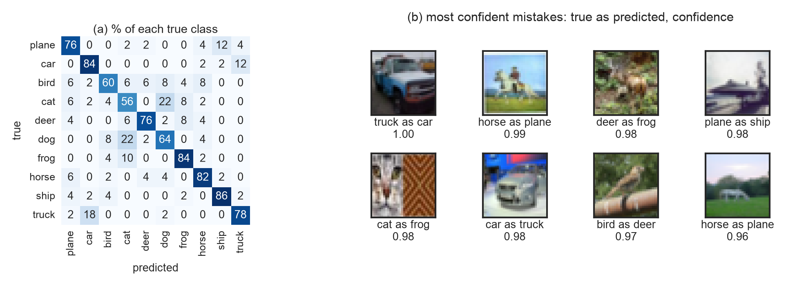
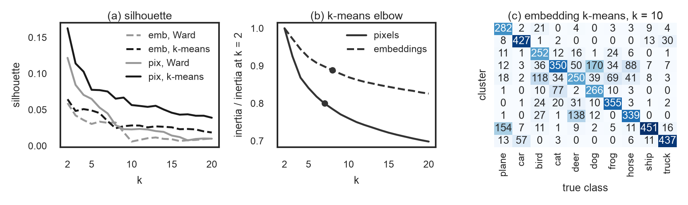
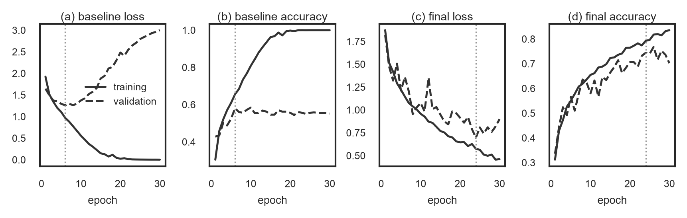

# CIFAR-10: exploring, clustering and classifying

A project that takes the CIFAR-10 image dataset through three stages:

1. **Explore and clean the data.**
2. **Find the classes without using any labels.**
3. **Train a CNN from scratch to classify the images.**

Everything runs on a laptop. I used an M2 MacBook Air, and all training runs together took about 9 minutes.

The full write-up is in [report/report.pdf](report/report.pdf) (5 pages). The code and outputs are in [cifar10.ipynb](cifar10.ipynb).

## Results

| | |
|---|---|
| Final test accuracy | 0.746 (500 test images, ±0.038) |
| Baseline validation accuracy | 0.528 to 0.580 across three seeds |
| Final model validation accuracy | 0.738 to 0.744 across three seeds |
| Best clustering (ResNet-18 embeddings, k-means, k = 10) | ARI 0.461 |
| Same clustering on raw pixels | ARI 0.044 |

Cat and dog were the hardest pair at every stage. They look alike in raw pixels, they share clusters without labels, and the CNN mixes them up 22% of the time each way.



## What each stage does

**1. Data and cleaning**
- Picks a stratified sample of 500 training, 50 validation and 50 test images per class, using seed 32.
- Finds near-duplicate images with PCA and a nearest/second-nearest distance ratio, the same idea as Lowe's SIFT matching. Training images that had a copy in the validation or test samples were swapped out.
- Flags unusually dark, bright, high-contrast or blurry images with a robust z-score.
- Measures which classes look alike from each image's 10 nearest neighbours.

**2. Clustering without labels**
- Compares raw pixels with 512-number embeddings from an ImageNet-trained ResNet-18.
- Reduces both with PCA, then clusters with k-means and Ward for k from 2 to 20.
- The silhouette picked k = 2. With embeddings that split is animals against vehicles, with 95.1% agreement.



**3. CNN from scratch**
- A small baseline CNN overfits after 6 epochs.
- Augmentation, batch normalisation, dropout and a deeper VGG-style network were each tried on their own, then combined.
- The final model uses augmentation, batch normalisation and the deeper network. The test set was used once, at the end.



## Running it

You need Python 3.13.

```
python -m venv .venv
source .venv/bin/activate
pip install -r requirements.txt
jupyter notebook cifar10.ipynb
```

The notebook downloads CIFAR-10 into `data/` on the first run and saves figures to `figures/`. The report builds with `tectonic main.tex` inside `report/` and expects Arial to be installed.

## Files

```
cifar10.ipynb          all the code, with outputs
figures/               figures used in the report
report/report.pdf      the write-up (5 pages)
report/main.tex        report source
report/references.bib
requirements.txt       pinned package versions
```

## Licence

MIT, see [LICENSE](LICENSE).
